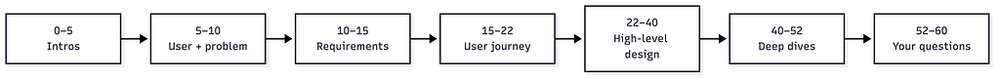
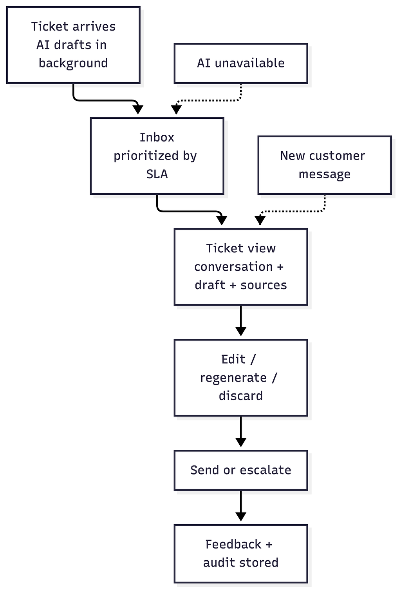
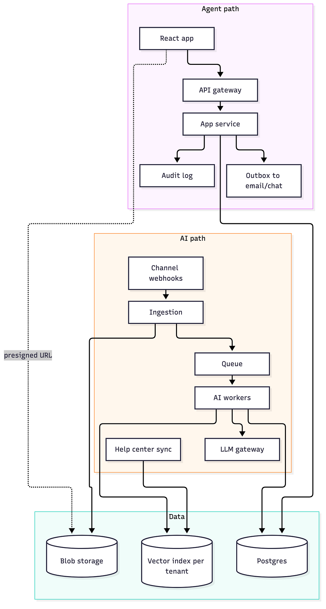

*A person interacts with an application, revealing the connected systems behind its interface*

Most system design prep teaches you to design Twitter. You estimate QPS, shard a database, add a cache, and argue about fan-out on write. Then you walk into the interview and get asked to design a product, where the screen the user stares at all day matters as much as the servers behind it.

That’s the product system design interview. Some companies call it product architecture. It is also a good stress test for any system design framework. Most frameworks grew up around infrastructure problems, and a product round pushes on exactly the parts they tend to skip: the user, the screen, and the workflow. There are plenty of guides for the infrastructure round and a growing number for product managers facing AI design cases, but very little written for engineers about the product round itself, worked through on one problem from start to finish. This article takes one well-known framework, applies it to a product-focused, AI-assisted problem end to end, and reflects on where it holds up and where it needs adapting.

One thing up front. The step-by-step structure I use here is not mine. It comes from Hello Interview’s [Delivery Framework](https://www.hellointerview.com/learn/system-design/in-a-hurry/delivery), which is part of their free [System Design in a Hurry](https://www.hellointerview.com/learn/system-design/in-a-hurry/introduction) guide. My contribution is applying it to a product-focused, AI-assisted problem and reflecting on what makes it work. If you only read one thing after this, read their framework.

## What a product system design interview is

The format is usually 45 to 60 minutes on a shared whiteboard like FigJam, Excalidraw, or Miro. You get a product prompt and you design it with the interviewer, out loud.

The axes interviewers commonly evaluate on:

- High-level application architecture
- Product thinking and the user flow
- Reasoning through tradeoffs and edge cases
- How frontend, backend, and increasingly AI systems fit together

The theme across all of them is clarity over completeness. Nobody expects a finished system in an hour. They want to see you pick a direction, explain why, and adjust when pushed.

The main difference from a classic infrastructure round is where the weight sits. In “design a URL shortener,” the user experience is one box labelled “client.” In a product round, the user journey and the UI workflow are first-class. You’ll be asked what the user sees, what happens when they click, what they see when something goes wrong, and how the API supports that. Scale still comes up, but usually as a follow-up rather than the main event.

Hello Interview has a good write-up on [preparing for Meta’s Product Architecture interview](https://www.hellointerview.com/blog/how-to-prepare-meta-pa) and a separate one on [how it differs from Meta’s System Design interview](https://www.hellointerview.com/blog/meta-system-vs-product-design). Even if you’re not interviewing at Meta, both are useful for understanding the shape of this kind of round.

## The structure

The Delivery Framework breaks the hour into five steps:

1. Requirements
2. Core entities
3. API or system interface
4. High-level design
5. Deep dives

For a product round, I made one change. I added an explicit user journey step right after requirements. Then I let the entities and the API fall out of the journey instead of inventing them in the abstract.

This sounds small, but it changes how the whole hour feels. Once you’ve walked the user through the product screen by screen, the entities are just the nouns you kept saying, and the endpoints are just the things each screen needs to load or change. You stop guessing and start reading them off the board.

## A realistic time budget for 60 minutes

Here’s a budget that works:

- 0–5: intros
- 5–10: the user and the problem, plus 2–3 clarifying questions
- 10–15: requirements (3 functional, about 4 non-functional, and an out-of-scope list)
- 15–22: user journey
- 22–40: high-level design, with endpoints written on the arrows and key fields on the database box
- 40–52: deep dives, usually driven by the interviewer’s “what if” questions
- 52–60: your questions for them



*A 60-minute budget that works. High-level design gets the biggest slice.*

The two places people lose time are requirements and deep dives. Requirements expand if you let them. Deep dives expand because they’re fun. Keep a clock visible and move on when a block is done.

## Worked example: an AI support reply copilot

Let’s use a problem with a shape that’s common in AI-assisted product questions: AI prepares work in the background, and a human reviews and acts on it.

The prompt: “Design a tool for a B2B helpdesk product where AI drafts replies to incoming support tickets and support agents review and send them.”

One caveat before we start. In a real round, the AI system may already exist and be declared out of scope. Then the interviewer wants you to design the product around it. Design Gurus’ [guide to AI system design interviews](https://www.designgurus.io/blog/ai-system-design-interview) makes a related point: software engineers are increasingly asked how they’d add a model, a RAG pipeline, or an agent to a product, while for ML engineers the model itself is the core round. Ask which lane you’re in.

I still cover the AI path below, but only to the depth a product engineer needs: what it produces, roughly how long it takes, how its results reach the screen, and what the user sees when it fails. If your interviewer draws that box for you, take it and spend the time on the user instead.

### User and problem

The primary user is a support agent. They work through a queue of email and chat tickets all day, often 50 to 100 or more. A secondary user is the team lead, who handles escalations. I’d put their dashboards out of scope.

The problems worth solving:

- Slow first response times break SLAs.
- Agents spend time hunting through the help center for the right answer.
- Answers are inconsistent between agents.

The key assumption to say out loud: the AI drafts, a human approves and sends. Nothing is auto-sent to customers in v1.

For success metrics I’d name first response time, handle time per ticket, draft acceptance and edit rates, and customer satisfaction on AI-assisted replies.

### Requirements

Functional, three of them:

1. Agents see a prioritized inbox of tickets, each with an AI draft ready.
2. Agents open a ticket and see the conversation plus an AI draft whose claims cite the help-center articles they came from.
3. Agents send, edit, regenerate, or discard the draft. Every decision is recorded.

Out of scope, said out loud: the email and chat channel integrations themselves, analytics dashboards, model training, SSO and user management, and billing.

Non-functional, four presented:

- Fast reads. The inbox loads in about 300 ms because it serves precomputed drafts, never a live model call.
- AI is async and never blocks the agent. If the model is down, there’s a full manual path.
- Multi-tenant privacy. Each company’s tickets and knowledge base are fully isolated, customer personal data is protected, and the model vendor is contractually barred from retaining or training on the data.
- A reply is never sent twice, and never sent on a stale thread.

I kept a few more in my back pocket: precision over recall (a bad draft costs more than no draft), groundedness (citations must exist in the knowledge base), observability and evals, and a keyboard-driven, virtualized UI. More on the back pocket later.

### User journey

This is the centerpiece of a product round.

1. A ticket arrives by email or chat. In the background, AI classifies it (topic, urgency, sentiment), retrieves relevant help-center articles, and drafts a reply before any agent opens it.
2. The inbox is prioritized by SLA deadline, priority, and customer tier.
3. The ticket view shows the conversation on one side and the draft on the other. Each claim in the draft links to its source article. A confidence indicator says high, medium, or low. I avoided percentages because they suggest a precision the model doesn’t have.
4. The agent edits inline, regenerates with an instruction like “shorter” or “more formal,” or discards and writes manually. All of it works from the keyboard.
5. The agent sends, or escalates to a team lead.
6. The decision is stored as feedback and as an audit trail.

Two edge cases are worth drawing. If the AI is unavailable, the inbox still fills and the agent writes manually. If the customer sends a new message while the agent is editing, a new draft is generated and a banner appears. The agent’s edits are kept, and send is blocked until they’ve seen the new message.



*The user journey. Dotted arrows are the two edge cases that interrupt the happy path.*

The product points I wanted to land: the agent never waits on the AI, and trust comes from cited sources plus a human click. The hard UX problem here is trust.

### Core entities

One line each:

- Organization: the tenant
- Agent: a user with a role
- Ticket: status, priority, sla_due, assigned_to, version
- Message: ticket, author, body, channel
- KnowledgeArticle: a help-center article and its chunks
- DraftJob: what triggered it, plus model and prompt version
- Draft: body, citations (article plus passage), confidence, status
- Decision: draft, agent, action, final text, reason
- AuditEvent: append-only

The point to stress most: name your entities early and say how they relate. For example: “A ticket is one conversation. It has many messages. A draft cites passages inside knowledge articles.” Ambiguous naming confuses interviewers fast, and it is one of the most common ways candidates lose minutes. More on that below.

### API

```text
GET    /v1/inbox?status=open&sort=sla&cursor=...
POST   /v1/tickets/{id}/claim              # soft lock with TTL
GET    /v1/tickets/{id}                    # ticket + messages + current draft
POST   /v1/tickets/{id}/drafts             # regenerate: 202 Accepted { jobId }
GET    /v1/tickets/{id}/events             # SSE: draft ready, new customer message
PATCH  /v1/drafts/{id}                     # autosave edits
POST   /v1/tickets/{id}/send               # Idempotency-Key + If-Match: <version>
POST   /v1/tickets/{id}/escalate           # { to: "lead", note }
POST   /v1/drafts/{id}/feedback            # { action, reason? }
```

A few choices worth explaining as you write these:

- Identity and tenant come from the auth token, never from the request body.
- The inbox uses cursor pagination because it shifts as tickets arrive and close.
- Attachments are served through short-lived [presigned URLs](https://docs.aws.amazon.com/AmazonS3/latest/userguide/using-presigned-url.html) from private blob storage, issued after an auth check.
- “Draft ready” and “new message” are pushed with [server-sent events](https://developer.mozilla.org/en-US/docs/Web/API/Server-sent_events). The updates only flow one way, so WebSockets would be more than we need. Hello Interview’s [Real-time Updates pattern](https://www.hellointerview.com/learn/system-design/patterns/realtime-updates) compares the options well.
- Edits autosave, so nothing is lost if the tab closes.
- Send is idempotent and version-checked.

### High-level design

The system splits into two halves.

The agent path: a React app talks to an API gateway (auth), which talks to an app service backed by Postgres with read replicas. The app service writes an audit log. Attachments are fetched directly from blob storage via presigned URL. Outbound replies go through an outbox to the email or chat provider.

The AI path: channel webhooks hit an ingestion service, which stores the message, bumps the ticket version, and publishes an event to a queue. AI workers pick it up, classify the ticket, retrieve passages from a per-tenant vector index of the help center, draft a reply via an LLM gateway, validate the citations, and write the draft to Postgres. A separate sync job keeps the vector index fresh when articles change.



*The agent path and the AI path only meet at the data layer.*

The one-sentence summary I’d say out loud: AI writes validated, cited drafts in the background, and the agent’s path only reads precomputed results, so it stays fast even when the model doesn’t.

A practical tip: build this diagram progressively in the interview. Start from the user’s first request and add boxes as the story needs them. Drawing everything at once looks rehearsed and is harder to follow.

### Deep dives

Prepare five or six and expect to get through two in a real session. Here are the two that matter most for this problem.

The model is wrong. This is the one to expect from almost any interviewer. Layers of defense:

- Ground drafts in retrieved articles and ask for structured output.
- Validate citations. The cited passage must actually exist in the knowledge base.
- Add a deterministic policy layer, for example “never promise refunds or delivery dates.”
- Tune confidence thresholds. Low confidence means no draft, only suggested articles.
- Keep the human in the loop.
- Build an eval set from past edits and discards, and roll out model or prompt changes as a canary.

Optionally, a fast verifier call can check each sentence: “Does this passage support this sentence? Yes or no, with a score.” Decision-style model APIs are an emerging option here. OpenAI’s [Decisions API](https://developers.openai.com/api/docs/guides/decisions) and TypeSafe’s [Jev](https://docs.typesafe.ai/introduction) both return typed answers like yes/no probabilities instead of generated text. They’re very new, so I’d mention them as one option, not a requirement.

Send safety. Sending the wrong reply, or the same reply twice, is the most visible failure in the product. Four tools cover it:

- A claim lock with a TTL, so two agents don’t work the same ticket. It’s the same idea as holding a concert seat during checkout, which Hello Interview’s [Ticketmaster breakdown](https://www.hellointerview.com/learn/system-design/problem-breakdowns/ticketmaster) explains well.
- An [idempotency key](https://docs.stripe.com/api/idempotent_requests) on send, also passed to the email provider.
- Optimistic locking on the ticket version. If a new customer message arrived, send returns 409.
- A [transactional outbox](https://microservices.io/patterns/data/transactional-outbox.html), so the database and the outbound send never disagree.

The others, briefly:

- Model down or slow: the queue absorbs it, with retries and backoff, a circuit breaker, a fallback model, SLA-based priority, and the manual path.
- Long threads and cost: summarize long threads, retrieve only relevant passages, use a cheap model for classification and a strong one for drafting, cache prompts, and use provider batch APIs for non-urgent work like re-drafting after a knowledge base update.
- Workflow versus agent: drafting is a fixed workflow. Use an agent only where the next step depends on what was found, like “where’s my order?” needing the order system and then the carrier. Give it narrow read-only tools, step caps, saved state, and human approval before anything is sent or refunded.
- Collaboration: if two agents co-edit a draft, a CRDT library like [Yjs](https://github.com/yjs/yjs) over WebSockets works. For send, keep optimistic locking, because conflicts there should be surfaced to a human, not merged.

## Study material vs. interview material

This is the most useful distinction to make while preparing.

Everything above is study material. You need to understand all of it. But in the interview you can’t say all of it, and you shouldn’t try.

Split your prep into two layers.

The first layer is what you present. It’s short stickies on the board. “Precomputed drafts.” “Never auto-send.” “Idempotent send.” You talk while you draw, and each sticky is a hook for a sentence or two.

The second layer is back-pocket knowledge. You bring it out only when the interviewer probes. If they ask how you’d stop a double send, that’s when you explain idempotency keys and the outbox. If they don’t ask, you don’t spend five minutes on it.

A good test: if you can’t say it in one sentence, it’s back pocket.

### A back-pocket glossary

These are terms worth being able to explain in one or two sentences each:

- RBAC: role-based access control. Permissions attach to roles like “agent” or “lead,” not to individual users.
- PII: personally identifiable information. Names, emails, addresses. Keep it out of logs and prompts where you can.
- DPA and zero data retention: the contract terms that stop a model vendor from storing or training on your customers’ data.
- KMS: a key management service for encryption keys. Per-tenant keys are an advanced multi-tenancy step.
- Presigned URL: a short-lived URL that grants access to one private file without exposing the bucket.
- Idempotency key: a client-generated ID that makes retrying a request safe.
- Optimistic locking: write only if the version hasn’t changed since you read it. Otherwise fail and let the user decide.
- Transactional outbox: write the outgoing message to a table in the same transaction as the state change, and have a separate process deliver it.
- SSE vs. WebSockets: SSE is one-way server push over HTTP. WebSockets are two-way. Use the simpler one when you can.
- CRDT: a data structure that lets concurrent edits merge without conflicts. Good for co-editing, wrong for actions that need a human decision.

## What the framework doesn’t tell you

A framework gives you a track to run on. It doesn’t tell you how the track bends in a real round. The worked example above is a clean, self-directed run; real rounds differ from it in a few predictable ways, and that is where the framework alone isn’t enough.

The format often isn’t what you practiced. Some requirements may be given upfront, and parts of the system, including the AI component itself, may be declared out of scope. Interviewers frequently stress the UI workflow. All of that shifts the balance of the hour, so be ready to re-plan on the spot.

What the framework gets you, if you use it well:

- Saying early that AI results are precomputed and never block the user. It frames everything after it.
- Explaining presigned URLs with reasons: large files, sensitive data, short expiry.
- Reasoning out loud through a real tradeoff. For example, choosing between batching all of a user’s decisions on the client and saving each one immediately. Save-each usually wins, because users walk away and connections drop.
- Edge cases. A soft lock with a TTL, an idempotent final action, new data arriving mid-review, virtualized lists, lazy-loading heavy content, and keeping sensitive data out of logs.

What it leaves to you, and where people lose points:

- Not locking down entity names and relationships in the first minutes. Using two overlapping terms for related things forces the interviewer to stop you and clarify.
- Ignoring the interviewer’s stated emphasis. If they ask for the UI workflow, spend the time on the main screen and on how each AI suggestion shows its evidence.
- Treating out of scope as an invitation. Minutes spent on AI internals that were declared out of scope are minutes that should have gone to the screen. One sentence, then move on.
- Starting multi-tenancy with the advanced items. Begin with the basics: a tenant ID on every record and every query scoped from the auth token. Only then things like customer-managed encryption keys.
- Narrating as a stream of consciousness. “Three things here: one, two, three” is much easier to follow.
- Refusing help with the tool. Interviewers will often offer to draw boxes for you. Say yes. It’s not a test of your whiteboard skills.

## How to prepare in a week

Here’s a plan that fits in a week:

- Days 1–2: read the [Delivery Framework](https://www.hellointerview.com/learn/system-design/in-a-hurry/delivery) and Hello Interview’s [how to prepare](https://www.hellointerview.com/learn/system-design/in-a-hurry/how-to-prepare) guide. Write your own one-page template.
- Day 3: pick a product relevant to the company’s domain. Do the user, problem, requirements, and journey on paper.
- Day 4: architecture and API. Draw it progressively on a blank board.
- Day 5: prepare 4–5 deep dives, each as “problem, approach, tradeoff, one-liner.”
- Day 6: compress everything into stickies. Do a timed 30-minute run out loud.
- Day 7: light review. Set up your whiteboard tool and learn its shortcuts. Sleep.

On the day itself:

- Keep three anchor points on a sticky note next to your screen.
- Have an opening line ready, so the first minute isn’t spent finding your feet.
- When something is ambiguous, say “I’ll assume X and move on.”
- Offer depth instead of forcing it: “Want me to go deeper here, or keep moving?”

## Further reading and tools

Hello Interview, where the structure comes from:

- [Delivery Framework](https://www.hellointerview.com/learn/system-design/in-a-hurry/delivery): the five-step structure this article is built on
- [System Design in a Hurry](https://www.hellointerview.com/learn/system-design/in-a-hurry/introduction): the full free guide
- [How to Prepare for System Design Interviews](https://www.hellointerview.com/learn/system-design/in-a-hurry/how-to-prepare)
- [Real-time Updates pattern](https://www.hellointerview.com/learn/system-design/patterns/realtime-updates): polling vs. SSE vs. WebSockets
- [Ticketmaster breakdown](https://www.hellointerview.com/learn/system-design/problem-breakdowns/ticketmaster): the seat reservation lock
- [Meta’s Product Architecture Interview: How to Prepare](https://www.hellointerview.com/blog/how-to-prepare-meta-pa)
- [Meta’s Product Architecture vs. System Design interviews](https://www.hellointerview.com/blog/meta-system-vs-product-design)

Concepts:

- [Server-sent events](https://developer.mozilla.org/en-US/docs/Web/API/Server-sent_events) on MDN
- [Idempotent requests](https://docs.stripe.com/api/idempotent_requests) in the Stripe API docs
- [Transactional outbox](https://microservices.io/patterns/data/transactional-outbox.html) on microservices.io
- [Presigned URLs](https://docs.aws.amazon.com/AmazonS3/latest/userguide/using-presigned-url.html) in the Amazon S3 docs

Libraries:

- [Yjs](https://github.com/yjs/yjs) and [Automerge](https://automerge.org) for CRDTs; [Velt’s CRDT overview](https://docs.velt.dev/realtime-collaboration/crdt/overview) is a readable intro
- [TanStack Virtual](https://tanstack.com/virtual) and [react-window](https://github.com/bvaughn/react-window) for virtualized lists
- [OpenAI Decisions API](https://developers.openai.com/api/docs/guides/decisions) and [TypeSafe Jev](https://docs.typesafe.ai/introduction), two new decision-model APIs

Related guides:

- [AI System Design Interview: The Complete Guide](https://www.designgurus.io/blog/ai-system-design-interview) on Design Gurus, on how the round differs for software and ML engineers
- [Guide: AI System Design Interviews](https://www.news.aakashg.com/p/ai-system-design-interview-your) by Aakash Gupta, the PM-facing counterpart to this article

Whiteboards and diagrams:

- [Excalidraw](https://excalidraw.com), [FigJam](https://www.figma.com/figjam/), and [Mermaid](https://mermaid.js.org) for diagrams as code

## Closing

So what makes a great system design framework? Not the number of steps. It is whether the framework tells you what to do with the time, forces the user to the front early, and leaves room to adapt when the interviewer changes the shape of the problem. The Delivery Framework does the first very well. The explicit user journey step and the study-versus-interview split are what it took to get the other two for a product round. If you take one thing from this, practice out loud with a timer. Reading about a framework feels like progress, but the first time you try to fit requirements into five minutes you’ll see where the real work is. Treat the framework as a track to run on, not a script to recite. The interviewer wants to see how you think about the user, and the structure just makes sure you get there.
