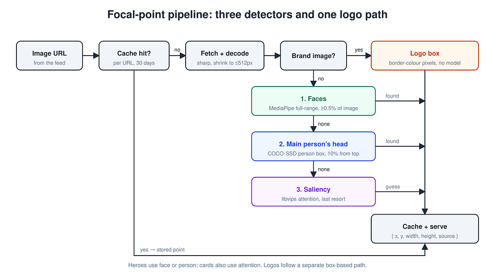

> This is part two of a two-part series. If you missed it, start with [part one](/blog/stop-cutting-heads-off-your-hero-images) to see how the page keeps faces in the frame.

In 2018 Twitter let a saliency model decide which part of every photo stayed in the preview. Three years later its own researchers measured whose faces that crop kept, and recommended removing it. That is why the chain in this article looks for faces first and only falls back to saliency when there is nothing else to aim at.

In [part one](/blog/stop-cutting-heads-off-your-hero-images) we stopped a hero banner cutting people’s heads off without cropping a single file. The client stores one focal point per image, converts it for the box it lands in, and sets object-position. That works with any point. This article is about producing a good one automatically, for thousands of images nobody will ever hand-edit, and doing it inside a server that renders pages without slowing them down.

There are no changes in terms of contrast. For each image URL the server returns a point as percentages of the image, the analyzed image’s width and height, and the name of the detector that produced it. Brand images return a box and a background colour instead. Everything is cached, and a miss falls back to the default centre crop rather than blocking the page.

## Faces, then people, then saliency

The idea is pretty simple: each image gets passed through a chain of detectors, starting with the ones we trust most. Whichever one finds something useful first, that’s the one we go with. Brand images skip the chain and go to the logo check. Every result is cached along with the name of the detector that produced it.



*Figure 1. How the focal-point pipeline chooses a detector*

As Figure 1 shows, after one cache lookup the pipeline tries faces, then the main person’s head, then saliency, while logos take their own path.

Ours runs in Node, in the same process that renders the page, using TensorFlow\.js on its WebAssembly backend. That means there is no GPU to provision and no vision API to pay for, though nothing below depends on that choice. The samples are TypeScript, and every piece has an equivalent on other stacks.

- Decoding uses [sharp](https://sharp.pixelplumbing.com/), which wraps libvips. libvips has bindings for most server languages, and Pillow or ImageMagick also work.
- Faces come from MediaPipe, which also runs in Python and the browser. OpenCV’s YuNet, or any detector that returns boxes, will slot in.
- People need any COCO-trained detector with a person class.
- Saliency is libvips’s attention crop, which every binding can reach. smartcrop.js and smartcrop.py are close alternatives.
- The cache is whatever you already have, keyed by URL.
- The client is one CSS property, set inline or from a data attribute in any framework.

Images are first decoded and shrunk to fit 512×512, which is all the detail a face detector needs and keeps the work small. Helpers such as fetchImage and decodeForAnalysis, and the FaceBox, PersonBox and RawImage types, are left out for brevity.

```ts
type ImageFocus = Focus & { source: 'face' | 'person' | 'attention' };

// A broken model must not take the later fallbacks down with it.
const safely = <T>(name: string, run: Promise<T[]>) =>
  run.catch((err) => {
    console.warn(`${name} detector failed`, err);
    return [] as T[];
  });

const computeImageFocus = async (url: string): Promise<ImageFocus | null> => {
  const image = await decodeForAnalysis(await fetchImage(url)); // RGB, max 512px
  if (!image) return null;
  // the client needs the analysed size to know which axis will be cropped
  const size = { imageWidth: image.width, imageHeight: image.height };

  const faces = await safely('face', detectFaces(image.data, image.width, image.height));
  const face = facesFocus(faces, image.width, image.height);
  if (face) return { ...face, ...size, source: 'face' };

  const people = await safely('person', detectPeople(image.data, image.width, image.height));
  const head = personFocus(people, image.width, image.height);
  if (head) return { ...head, ...size, source: 'person' };

  return { ...(await attentionFocus(image)), ...size, source: 'attention' };
};
```

## Faces first

We use MediaPipe’s full-range face detector through @tensorflow-models/face-detection. The full-range model finds the smaller faces in wide shots, which the short-range selfie model misses. Two rules turn a list of boxes into one point.

- Ignore faces smaller than 0.5% of the image, because in a film still or a crowd they belong to background people.
- Keep every face at least half the size of the largest and aim at the centre of that group. A band photo is framed around the middle of the band, and an extra in the corner can’t drag the crop away. In a narrow box, members at the edges can still be cut off.

```ts
const MIN_FACE_AREA = 0.005;
const GROUP_FACE_RATIO = 0.5;
 
export const facesFocus = (faces: FaceBox[], width: number, height: number) => {
  const area = (f: FaceBox) => f.width * f.height;
  const subjects = faces.filter((f) => area(f) >= MIN_FACE_AREA * width * height);
  if (!subjects.length) return null;
 
  const largest = Math.max(...subjects.map(area));
  const group = subjects.filter((f) => area(f) >= largest * GROUP_FACE_RATIO);
  const cx = group.reduce((s, f) => s + f.xMin + f.width / 2, 0) / group.length;
  const cy = group.reduce((s, f) => s + f.yMin + f.height / 2, 0) / group.length;
  return { x: (cx / width) * 100, y: (cy / height) * 100 };
};
```

[Cloudflare](https://blog.cloudflare.com/ai-face-cropping-for-images/) centres the box that holds every face instead. That works for group portraits, but a single background face can pull it off the subject. The size filter avoids that.

## The main person’s head

A face detector misses racing drivers in helmets and masked characters, along with people in profile and some stage shots. For those we run the COCO-SSD detector built on SSDLite MobileNet v2 and keep only the person class. We take the largest person and aim at their head, which sits about 10% down from the top of a standing or half-length box.

Two checks stop it guessing badly.

- A person under 3% of the image is a background figure, so we return nothing.
- A box taller than 75% of the image is a close-up whose top edge is usually hair or a hat, so we return nothing and let saliency decide.

```ts
const MIN_PERSON_AREA = 0.03;
const MAX_PERSON_HEIGHT = 0.75;
const HEAD_OFFSET = 0.1;
 
export const personFocus = (people: PersonBox[], width: number, height: number) => {
  const area = (p: PersonBox) => p.width * p.height;
  const main = [...people].sort((a, b) => area(b) - area(a))[0];
  if (!main || area(main) < MIN_PERSON_AREA * width * height) return null;
  if (main.height > MAX_PERSON_HEIGHT * height) return null;
  return {
    x: ((main.xMin + main.width / 2) / width) * 100,
    y: ((main.yMin + main.height * HEAD_OFFSET) / height) * 100,
  };
};
```

## Saliency from libvips

When there’s no person, sharp’s attention strategy makes the guess using the saliency scoring built into libvips, which weighs luminance frequency and saturation along with skin tones. It returns the offset of a crop along the cropped axis instead of a point, so we ask twice with a half-width window and a half-height one and read the centre of each window.

```ts
export const attentionFocus = async ({ data, width, height }: RawImage) => {
  const raw = { raw: { width, height, channels: 3 as const } };
  const offset = async (w: number, h: number) => {
    const { info } = await sharp(data, raw)
      .resize(w, h, { fit: 'cover', position: sharp.strategy.attention })
      .toBuffer({ resolveWithObject: true });
    // sharp reports attention crop offsets as negative numbers
    return { left: -(info.cropOffsetLeft ?? 0), top: -(info.cropOffsetTop ?? 0) };
  };
  const hw = Math.round(width / 2);
  const hh = Math.round(height / 2);
  const [{ left }, { top }] = await Promise.all([offset(hw, height), offset(width, hh)]);
  return { x: ((left + hw / 2) / width) * 100, y: ((top + hh / 2) / height) * 100 };
};
```

The result records which detector produced it (face, person or attention), and the client uses that. A hero banner crops hard, so we only move it for a face or a person and keep the default centre for a saliency guess. Small cards crop gently and can use any of the results.

## Logos need their own method

A logo has no face, and saliency tends to pick one letter of a wordmark. [Part one](/blog/stop-cutting-heads-off-your-hero-images) showed how the client frames the whole mark on its own background colour; the server’s job is to find the mark’s box and that colour.

Most logos sit on a flat or transparent background, so plain pixel checks do the job without any model.

1. Read the border pixels and take their median colour, then give up if fewer than 95% of them are within a small RGB distance of it, since that means the background isn’t flat.
2. Mark every pixel that differs from the background, or is opaque on a transparent image. A transparent image has no background colour to return, so the client uses the page background.
3. The first and last rows and columns with at least two marked pixels define the logo’s box, and the two-pixel rule stops JPEG speckles from stretching it.

The result is stored as a box and a colour rather than a point. If the border isn’t flat the image goes through the normal chain instead, and the client falls back to a plain cover crop.

## Making it safe to run on every page view

Honestly, getting the detectors to actually work was the straightforward bit — the real headache was making all of this run during server rendering without grinding pages to a halt.

- **Repeat work.** Cache the result per image URL for about 30 days in whatever store you already use, and version the cache key so a better detector re-analyses everything.
- **Concurrent misses.** Keep a map of in-flight promises, so concurrent requests for one image share a single analysis.
- **Cold starts.** Load the image and ML libraries lazily, only on a cache miss.
- **Slow pages.** Give each batch of images a 1.5 s budget, and render anything not ready by then with the default crop while its result is cached for next time.
- **One CPU, one backend.** Run the models through a single promise queue, because the WASM backend runs single-threaded in our setup.
- **Huge originals.** Analyse a \~500px thumbnail instead of a multi-megabyte original when the source offers one, as Wikimedia does, and cap downloads at 10 MB.
- **Bad URLs.** Accept only public https hostnames and follow redirects by hand, checking every hop, so a stored image URL can never reach internal addresses through SSRF. Resolve each hostname yourself, reject private, loopback and link-local addresses, and connect to the address you checked, or DNS rebinding can slip past the check.
- **Model failures.** A throwing face or person model is logged and skipped, so the chain falls through to saliency and the page still renders.
- **Flaky upstreams.** Throw on timeouts and on 5xx or 429 responses so they stay out of the cache, and return null for missing or broken images since that is a stable answer worth caching.

There are three things that’ll catch you off guard, and they’re especially nasty if you’re deploying to serverless.

- Vendor the model weights, since most detector libraries download them from a model hub at runtime by default and every cold function then depends on that hub being up. Ship the weights with the code and load them from disk, with tf.io.fromMemory in TensorFlow\.js or a local path in Python.
- Bundle native and WASM binaries yourself. On a serverless host the install-time path to .wasm files or libvips’s shared libraries is often missing from the deployed bundle. Copy them into the project and point the loader at them, using setWasmPaths in TensorFlow\.js. Then list them in your platform’s file-tracing or include config, such as outputFileTracingIncludes in Next.js or includeFiles on Vercel. A Lambda layer or a container image also works.
- Load models once per process. Bundlers can give each route its own copy of your module while the ML library stays shared, so a module-level let detector loads the model once per route. Park the loading promise on a process-wide object such as globalThis in Node so it loads once. In a long-running Python or Go service, a plain module-level singleton is enough.

## Why faces come before saliency

Saliency alone is the obvious shortcut, and it has a public failure on record.

In 2018 Twitter [moved its image previews to a saliency model](https://blog.twitter.com/engineering/en_us/topics/infrastructure/2018/Smart-Auto-Cropping-of-Images.html) that cropped around the point people were most likely to look at. Its own team later [measured systematic disparities](https://arxiv.org/abs/2105.08667) in who that crop kept in view and found that cropping around the single most salient point amplified them. They recommended removing saliency cropping altogether. An [independent audit](https://openaccess.thecvf.com/content/WACV2022/papers/Birhane_Auditing_Saliency_Cropping_Algorithms_WACV_2022_paper.pdf) that also covered Google’s and Apple’s croppers raised similar concerns.

That’s why saliency is the last thing we try, not the first — and we never let a saliency guess shift a hero banner. That felt like the right call after reading that research. The rules are also explicit and easy to inspect, since every face at least half the size of the largest counts equally towards the point. A face detector can still miss people, so test it on a sample that looks like your real catalogue and covers a range of skin tones and ages along with varied lighting and headwear.

## Limitations

- MediaPipe and COCO-SSD find people without knowing which one matters. In a poster with two actors the crop frames both, even when the page is about only one of them.
- The logo heuristic needs a flat or transparent background. A logo on a photo or gradient falls back to the normal crop.
- The 1.5 s budget means the first visitor to an unseen image gets the default crop. Warming the cache when images are ingested would fix that.
- One point per image can’t serve two dissimilar subjects at two far-apart aspect ratios. A focal box, which our logo path already stores, is the natural next step.

## If you build this

- Start with what you trust most — faces — and only fall back to saliency when everything else has given up.
- Filter out small faces and frame faces of similar size together. Detectors return background people too.
- Cache per URL and load models lazily. Put a time budget on the page and vendor the weights and WASM files.
- Record which detector produced each point. A hero banner should only move for a face or a person, never on a saliency guess.

The whole thing ends up being a few hundred lines of TypeScript — surprisingly small, really — plus two open models weighing in at roughly 1 MB and 18 MB. We run it inside the server that renders the page, though it would work just as well as a small service in front of your renderer that returns a point per URL.

## Sources

- Twitter Engineering, [Smart Auto-Cropping of Images](https://blog.twitter.com/engineering/en_us/topics/infrastructure/2018/Smart-Auto-Cropping-of-Images.html) (2018)
- Yee, Tantipongpipat and Mishra, [Image Cropping on Twitter: Fairness Metrics, their Limitations, and the Importance of Representation, Design, and Agency](https://arxiv.org/abs/2105.08667) (CSCW 2021)
- Birhane, Prabhu and Whaley, [Auditing Saliency Cropping Algorithms](https://openaccess.thecvf.com/content/WACV2022/papers/Birhane_Auditing_Saliency_Cropping_Algorithms_WACV_2022_paper.pdf) (WACV 2022)
- Cloudflare, [AI face cropping for Images](https://blog.cloudflare.com/ai-face-cropping-for-images/) (2025)
- Appwrite, [Introducing AutoGravity](https://appwrite.io/blog/post/introducing-autogravity) (2026)
- [sharp](https://sharp.pixelplumbing.com/), [MediaPipe face detection for TensorFlow.js](https://github.com/tensorflow/tfjs-models/tree/master/face-detection), [COCO-SSD](https://github.com/tensorflow/tfjs-models/tree/master/coco-ssd)
