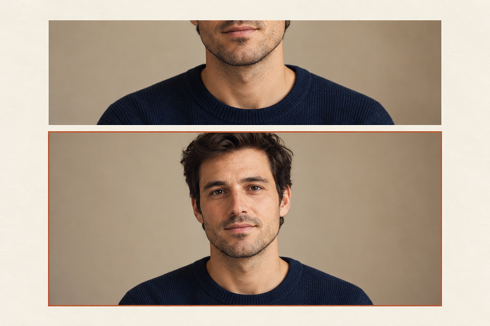
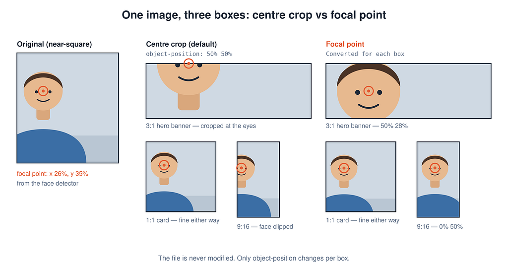
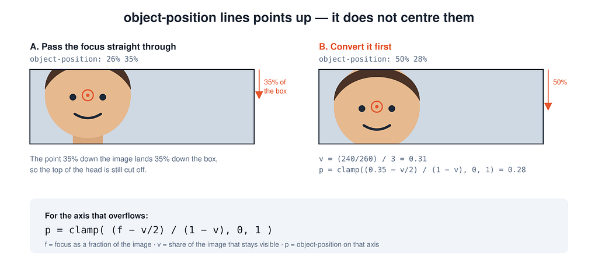
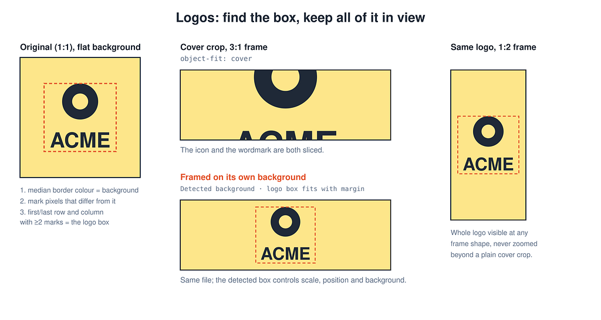

> This is part one of a two-part series. In [part two](/blog/finding-the-focal-point), we build the tool that finds the face in each photo.



*Conceptual illustration of the same portrait framed two ways*

## The headless hero banner

We put a portrait into a wide hero banner, and the browser cut the person’s head off.

Nothing was broken. The image was a standard, roughly square head-and-shoulders photo in a banner about three times wider than it was tall, styled with the usual CSS.

```css
.hero img {
  width: 100%;
  height: 100%;
  object-fit: cover;
}
```

With object-fit set to cover, the browser scales the image until it fills the box and crops whatever overflows. It keeps the centre by default, because object-position defaults to 50% 50%, and in a portrait the centre is the chest. The face sits in the top third, so a wide crop throws it away.

This article explains how I fixed it without cropping a single file. A server finds the part of the image worth keeping, which is usually a face, and the browser keeps that point in view with object-position.



*Figure 1. One image in several boxes with centre crop versus focal point*

*Figure 1 shows the same file in boxes ranging from a wide banner down to a tall mobile hero. The left column shows the default centre crop, and the right column uses an&#x20;*_object-position derived from the detected face, with nothing re-encoded._

## Where this matters

The problem really bites when you’re dealing with images you had no hand in shooting, dropped into layouts that were never designed around them.

- In hero banners, a wide crop over a portrait keeps the chest and loses the head. You want the face, or every face in a group shot.
- In avatars and cast lists, a small square cuts a half-length photo at the shoulders when you want one face in the centre.
- In cards and carousels the same image appears at several ratios on one page, so you want a single point that holds at every one of them.
- In film and TV stills, background extras pull the crop away from the lead actor. You want the largest face and nothing smaller.
- Helmets and masks in sports and costume shots defeat face detection, yet there is still a head to aim at. Part two covers this case.
- With brand logos, a cover crop slices the wordmark. You want the whole mark with some margin around it, on its own background colour.
- For user uploads and marketplace or news feeds, nobody sets a hotspot on every image, so you want whatever a person would look at first.

If your images come from a CMS where an editor sets a hotspot, you don’t need this. It helps when images arrive from external feeds or user uploads in numbers too large to curate by hand.

## Store a point instead of a crop

We store one focal point per image and let CSS do the cropping. That point works for every box the image lands in.

Most smart-crop tools return a new image cut to one aspect ratio. A page that shows the same image at several ratios then needs a separate crop and cache entry for each, plus new crops whenever the layout changes. A focal point is two numbers, x and y, given as percentages of the image. The original file is served unchanged and the browser crops it with object-fit set to cover. Art direction with the picture element and a hand-made crop per breakpoint also works, but only when someone makes every crop.

There are already tools that tackle pieces of this — CMS hotspots, Cloudflare’s face crops, Appwrite’s AutoGravity — and I’ll compare them properly at the end, but none of them quite did what I needed. What’s actually new here is stitching the whole server-side chain together — detect once, store a point, handle any box shape, and treat logos as a completely separate problem.

This part covers the browser side: storing a point, converting it so object-position actually centres it, and framing logos. A second article covers the server side, which produces the point with open models and adds two cases AutoGravity doesn’t handle, people whose face can’t be seen and logos. The contract between the two is small. The server sends a point and the analysed image’s size, along with the name of the detector that produced it. Everything below works with that point however it was made, whether by an editor, a hosted API, or the detector chain in [part two](/blog/finding-the-focal-point).

## object-position aligns a point with the box

Setting object-position to 30% 20% lines up the point 30% across the image with the point 30% across the box, and the point 20% down the image with the point 20% down the box. That point stays wherever the alignment puts it, which is usually off centre. A face 20% from the top of the image lands 20% from the top of the box, where it may still be cut off.



*Figure 2. object-position lines points up and leaves them off centre*

*In Figure 2 the focus is passed straight through on the left and converted for the box on the right.*

To centre the focus you have to convert it, and the conversion is manageable because with object-fit set to cover only one axis overflows. Let v be the share of that axis that stays visible and f the focus as a fraction. The visible window should start at f − v/2 clamped to the image. Then object-position takes that start as a share of the hidden part.

```text
p = clamp( (f − v/2) / (1 − v), 0, 1 )
```

```ts
type Focus = { x: number; y: number; imageWidth: number; imageHeight: number };
 
// focusPct is 0..100 (a percentage of the image); visibleFraction is 0..1.
const axisPosition = (focusPct: number, visibleFraction: number) => {
  if (visibleFraction >= 1) return 50; // nothing is cropped on this axis
  const start = focusPct / 100 - visibleFraction / 2;
  return Math.min(1, Math.max(0, start / (1 - visibleFraction))) * 100;
};
 
/** object-position that centres the focus in a box of aspect w / h. */
export const toCenteredObjectPosition = (focus: Focus, boxAspect: number) => {
  const imageAspect = focus.imageWidth / focus.imageHeight;
  // cover crops whichever axis overflows the box
  return imageAspect > boxAspect
    ? `${axisPosition(focus.x, boxAspect / imageAspect)}% 50%`
    : `50% ${axisPosition(focus.y, imageAspect / boxAspect)}%`;
};
```

A responsive hero has no single aspect ratio, and ours runs from 0.7 on the narrowest layout to 3.5 on the widest. Centre each axis for the box that crops it hardest, which means the narrowest box for x and the widest for y. The focus then stays in view at every size in between. This works because a looser crop only widens the visible window around the tightest one. It guarantees that the point stays visible, not the whole face.

```ts
const NARROWEST = 0.7;
const WIDEST = 3.5;
 
export const toBannerObjectPosition = (focus: Focus) => {
  const imageAspect = focus.imageWidth / focus.imageHeight;
  const x = axisPosition(focus.x, Math.min(1, NARROWEST / imageAspect));
  const y = axisPosition(focus.y, Math.min(1, imageAspect / WIDEST));
  return `${x}% ${y}%`;
};
```

This is why the server stores the analysed image’s width and height alongside the point. Only the ratio matters, but without it the client can’t tell which axis will be cropped. Part two also returns the name of the detector that found the point. A hero banner crops hard, so keep the default centre when that detector was only a saliency guess.

## Framing a logo

Logos are their own headache — there’s no face to find, and a saliency crop will cheerfully cut a wordmark right in half. What you want is the whole logo with some margin around it, shown on its own background colour. For that the server sends a box rather than a point, plus the background colour it found behind the mark; [part two](/blog/finding-the-focal-point) covers how it finds both. The client side needs no model.

On the client, the frame is filled with the detected background colour. The image is positioned with container query units (cqw, cqh) so that the logo’s box sits inside the frame with a margin. The whole logo stays visible at any frame shape, and it is never zoomed further than a plain cover crop would zoom it.

Here is the whole client side. The server’s box goes in as custom properties: the logo’s left, top, width and height as fractions of the image, plus the image’s aspect ratio. The 80cqw and 80cqh terms leave a 10% margin on every side. Container query units work in every major browser released since early 2023.

```css
.logo-frame {
  container-type: size;
  position: relative;
  overflow: hidden;
  background: var(--logo-bg);
}

.logo-frame img {
  position: absolute;
  max-width: none;
  /* the largest size that fits the logo with a 10% margin, capped at cover */
  --fit: min(
    80cqw / var(--bw),
    80cqh * var(--ar) / var(--bh),
    max(100cqw, 100cqh * var(--ar))
  );
  width: var(--fit);
  height: calc(var(--fit) / var(--ar));
  /* move the centre of the logo's box to the centre of the frame */
  left: calc(50cqw - (var(--bx) + var(--bw) / 2) * var(--fit));
  top: calc(50cqh - (var(--by) + var(--bh) / 2) * var(--fit) / var(--ar));
}
```



*Figure 3. Finding a logo’s box and keeping all of it in view*

*Figure 3 shows a plain cover crop slicing a tall mark in a wide frame, while framing the detected box on the detected background colour keeps all of it in any frame shape.*

## If you build this

- Store a focal point and let the cover value of object-fit do the cutting.
- Convert the focus with the image and box aspect ratios before passing it to object-position, which aligns points without centring them.
- For a responsive box, convert each axis for the size that crops it hardest, so one value holds across the whole range.
- Keep the analysed image’s width and height next to the point. Without them the client can’t tell which axis will be cropped.
- Treat logos as their own case by finding the box on a flat background and keeping all of it in view.

The point itself can come from anywhere: a CMS hotspot, a hosted API, or your own detector. [Part two](/blog/finding-the-focal-point) builds the detector, with faces first, a person’s head second and saliency last, and covers what it takes to run that on every page view. It ends with the next step for photos, which is storing a box instead of a point, as the logo path already does.

## Prior art

The default centre crop is basically a shrug — it costs nothing to implement and makes no real decision, which is exactly why it keeps failing. CMS hotspots in tools like [Sanity](https://www.sanity.io/answers/using-the-image-hot-spot-feature-in-a-next-js-project) and [Shopify](https://shopify.dev/docs/api/liquid/objects/focal_point) store a point, but an editor has to place it on every image. [Cloudflare](https://blog.cloudflare.com/ai-face-cropping-for-images/) runs RetinaFace on its GPUs and hands back a cropped file, so every new size is a new crop. Appwrite’s [AutoGravity](https://appwrite.io/blog/post/introducing-autogravity) is closest to what we built. It runs YuNet for faces and U²-Net for saliency, then returns a normalised point and leaves the image untouched.

The pieces have each been written up on their own. Stephanie Eckles’s [Object-Fit Focal Point](https://objectfit-focalpoint.netlify.app/) runs sharp’s entropy crop and emits an object-position for one aspect ratio. iO Digital showed [face detection feeding object-position](https://techhub.iodigital.com/articles/native-face-detection-cropping) in the browser, using Chrome’s flagged Face Detection API. Henry Desroches and Mats Odland both covered [hand-set focal points in CSS](https://henry.codes/writing/pure-css-focal-points/) and [the maths for centring one](https://odland.dev/2023/02/26/cropping-images-with-css-while-keeping-a-focal-point-in-the-center.html). What is new here is the whole chain on the server: faces first, then a person’s head, then saliency, stored once as a point and converted for a range of boxes, with a separate path for logos and the work needed to run it on every page view.

## Sources

- Cloudflare, [AI face cropping for Images](https://blog.cloudflare.com/ai-face-cropping-for-images/) (2025)
- Appwrite, [Introducing AutoGravity](https://appwrite.io/blog/post/introducing-autogravity) (2026)
- Stephanie Eckles, [Object-Fit Focal Point](https://objectfit-focalpoint.netlify.app/) (2021)
- iO Digital, [Smart cropping with native browser Face Detection](https://techhub.iodigital.com/articles/native-face-detection-cropping) (2022)
- Henry Desroches, [Using focal points, aspect ratio and object-fit to crop images correctly](https://henry.codes/writing/pure-css-focal-points/) (2022)
- Mats Odland, [Cropping Images with CSS While Keeping a Focal Point in the Center](https://odland.dev/2023/02/26/cropping-images-with-css-while-keeping-a-focal-point-in-the-center.html) (2023)
