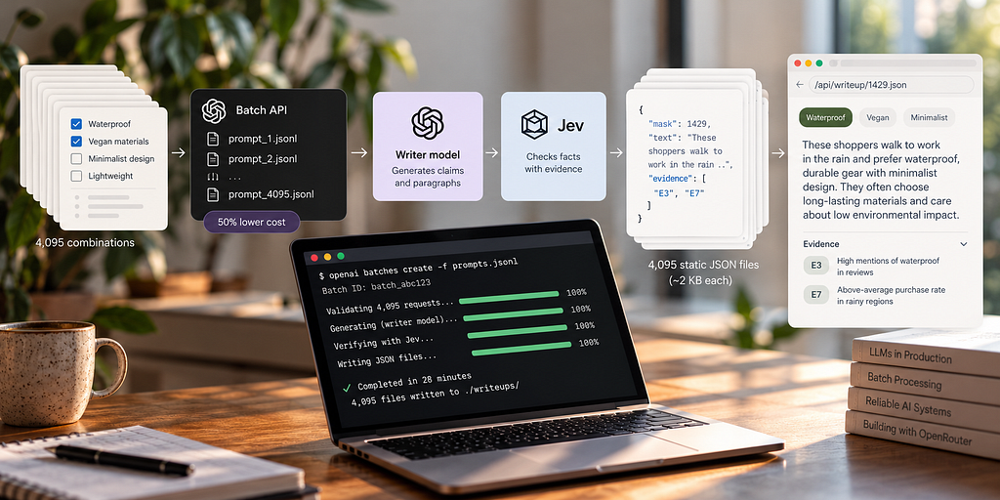
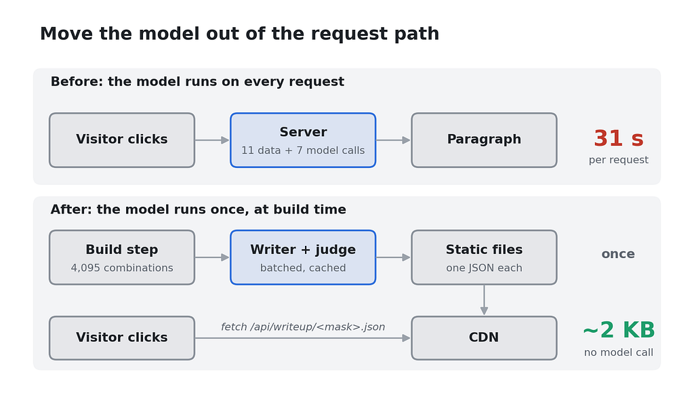
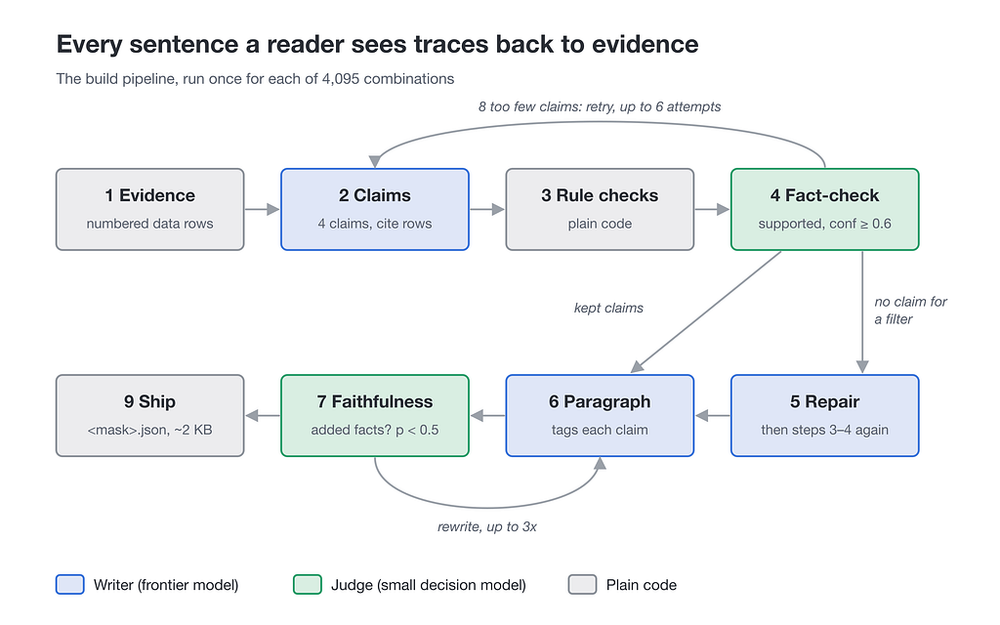
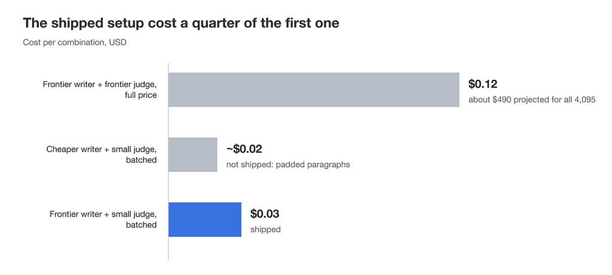

*Batch Pipeline for Verified Static Outputs*

## A model call per request is the wrong default

A recent project I worked on was a personalization demo. A visitor picks any of 12 items and gets a short paragraph describing people with those interests.

The first version called the model when the visitor clicked, and one request took 31 seconds because it made 11 data calls and 7 model calls. A cache would only have helped whoever asked for the same selection second.

Twelve items give 2¹² − 1 = 4,095 possible selections, which is few enough to generate every answer before anyone asks for it.

That makes the model’s output a build artifact: a build step generates and checks every paragraph offline and writes each one to a static file. The model now runs once, at build time, the way a compiler does.



The examples below use a made-up online shop instead of the original project. It has 12 filters such as “waterproof” and “vegan materials”, which gives 4,095 filter combinations, and each combination gets a short “who buys this” paragraph grounded in the shop’s own product attributes and reviews.

The approach rests on precomputing the whole space and on splitting the work between two models. A frontier model writes, and Jev checks what it wrote. Jev (typesafe/jev-1.13) is a small decision model from TypeSafe, available through OpenRouter, that returns typed answers with confidences instead of free text. The writer's calls go through a batch API at half price, behind a small queue that keeps the code as simple as a normal await.

## Precompute the whole space

The page never talks to a model. It fetches a file that the build step wrote earlier, one per combination.

Each selection is encoded as a bit field, where filter n sets bit n. The result is a number from 1 to 4,095 that also names the file.

```js
const mask = selected
 .reduce((m, i) => m | (1 << i), 0);
const res = await fetch(
 `/api/writeup/${mask}.json`);
```

A file is about 2 KB and a CDN serves it in milliseconds. Nothing in the request path needs an API key or can hit a rate limit, and the bill doesn’t grow with traffic.

Building ahead of time also means every output can be checked before a visitor sees it, which is impossible when the model writes at request time. The cost is paid once, during the build.

This only works while the space stays countable. Twelve inputs give 4,095 combinations, while twenty would give more than a million. Past some size, one full pass stops being affordable.

To ship before the run finishes, sort the work queue by how close each combination is to the default selection. The combinations a visitor reaches in one or two clicks are done first and can be published while the rest of the run continues.

## Every sentence traces to evidence

With the model out of the request path, there is time to check its work. The pipeline uses that time so that every sentence a shopper reads can be traced back to data.



Each combination goes through nine steps.

1. Evidence. Pull structured signals from the shop’s data, both for the whole combination and for each filter on its own. Each signal is credited to the filters that drive it and gets a row number such as E7.
2. Claims. The writer proposes 4 claims that cite evidence rows by id. Each must stay under 20 words and avoid explanatory clauses.
3. Rule checks. Plain code drops any claim that cites a row that doesn’t exist or names a forbidden term.
4. Fact-check. Jev gets one request per combination with one question per claim, and labels each claim supported, overstated or unsupported. A claim survives only as “supported” with a confidence of at least 0.6. Because Jev can’t rewrite anything, a weak claim is dropped.
5. Repair. When a filter has no surviving claim, the writer proposes one claim for it, and that claim goes through steps 3 and 4.
6. Paragraph. The writer turns the kept claims into 3 to 4 sentences and tags each claim’s phrase.
7. Faithfulness. Jev estimates the probability that the paragraph adds a fact none of the claims contain. At 0.5 or higher the writer rewrites the paragraph, up to 3 times.
8. Retry. If too few claims survive, the model steps run again with fresh answers, up to 6 attempts per combination.
9. Ship. The build writes one JSON file per combination.

A claim stays short and plain so that it can be checked against its rows.

```json
{
 "id": "C1",
 "text": "Shop for wet daily commutes",
 "evidence": ["E3", "E7"]
}
```

In the paragraph, a tag marks the phrase that came from each claim.

```html
These shoppers <b c="C1">walk to
work in the rain</b> and ...
```

The page uses that tag to show the evidence behind each phrase, so hovering over “walk to work in the rain” shows rows E3 and E7. A reader can check the paragraph without having to trust it.

This is a real claim from the project: “In restaurants and venues, they gravitate toward cozy, romantic, intimate settings.” Its evidence rows are below.

```json
{
  "id": "C1",
  "evidence": [
    { "name": "Cozy", "category": "Places", "score": 0.98 },
    { "name": "Romantic", "category": "Places", "score": 0.96 },
    { "name": "Intimate", "category": "Places", "score": 0.89 }
  ]
}
```

Splitting the work this way keeps each check narrow. A claim is judged on its own against the rows it names, and the paragraph is judged only on whether it adds anything, so a small model like Jev can handle both questions.

## A frontier model writes, Jev checks

To cut costs, I first used a smaller model as the writer. It kept adding explanations nobody asked for, such as “favoring calm, considered design over clutter”, and Jev correctly called them overstated. Only 25% of its claims survived.

That failure led to the rule limiting claims to 20 words without explanatory clauses, which raised survival to 52%. The paragraphs built from the survivors still read badly, though, with invented details and stilted boilerplate that the checks flagged but couldn’t fix.

So I went back to a frontier model, Claude Opus, for the writing. Writing is open-ended and its quality shows in every sentence, while judging asks a closed question about one claim and the few rows behind it. A small model handles that well.

Jev doesn’t take a free-form prompt. It takes a state object plus named questions and returns a typed answer for each. A choice question returns an option with a confidence, and a noul question returns the probability of yes.

The criteria are plain text, defined once.

```js
const criteria = {
  supported:
    'Every quality the claim names comes ' +
    'from its evidence, in plain words. ' +
    'Naming two signals together is supported.',
  overstated:
    'Adds something no evidence names: a ' +
    'detail, an absolute degree, a motive, ' +
    'or one new kind of item that merges ' +
    'separate signals.',
  unsupported:
    'The evidence does not point this way.',
};
```

One request then checks every claim in a combination.

```js
const state = { items: claims.map((cl) =>
  ({ claim: cl.text, evidence: cl.evidence })) };

const questions = Object.fromEntries(
  claims.map((_, i) => [`c${i}`, {
    type: 'choice',
    instructions: `Judge items[${i}].claim ` +
      `against only items[${i}].evidence.`,
    criteria,
  }]));

const { answers } = await post(
  'https://openrouter.ai/api/alpha/decisions',
  { model: 'typesafe/jev-1.13',
    state, questions });
```

Since the answers come back typed, keeping a claim is a plain filter.

```js
const kept = claims.filter((_, i) => {
  const a = answers[`c${i}`];
  return a?.choice === 'supported'
    && a.confidence >= 0.6;
});
```

Faithfulness uses a single noul question named added, and the writer rewrites the paragraph when its probability is 0.5 or higher. I set that threshold low because a rewrite costs little and padding that reaches a reader costs more.

Across the final run, all of Jev’s checks for 4,077 combinations cost $0.42.

## Test Jev before you trust it

Before Jev saw real work, I gave it cases with known answers. It labeled a supported, a deliberately overstated and an unsupported claim correctly, at confidences of 0.89, 1.00 and 0.82. It scored a faithful paragraph 0.18 for added facts and a paragraph with invented facts 0.97, and it agreed with the frontier model on 17 of the 18 claims that model had already approved.

That is a small smoke test, with 3 claims, 2 paragraphs and 18 cross-checked claims. It gave us enough confidence to start the run, and the run itself exposed what it missed.

The last 18 combinations kept failing. In one of them, the claim “drawn to detective work and corruption” rested on two evidence rows naming exactly those signals at maximum strength, and Jev still called it overstated with confidence up to 0.94.

Jev had read the two signals, named together, as a single new thing merged from both, and our first criteria never said that naming them together was allowed. I rewrote the criteria to say that naming signals together is supported and that only merging them into a single new kind of item is overstated. Those are the two sentences in the criteria above.

With the new wording, the misjudged claims passed at 0.84 to 0.97, while real overstatements still failed at 0.95 to 0.99. At the same time I raised the keep threshold from 0.5 to 0.6. The main run had used 0.5 with the first wording, and the new settings applied to the last 8 combinations.

Criteria for a decision model deserve the same care as code. I now keep a set of known cases and rerun it after every wording change, then read whatever still fails. When a run stalls on the same few inputs, the criteria are worth checking before the writer.

## Half-price batches you can await

Model providers offer a batch API at about half price, where you upload many requests at once and download the results when the batch finishes. Pipelines written around that shape end up as a submit-and-poll loop that matches results back to requests, which is hard to read and harder to change.

A small queue avoids that by letting pipeline code call batched(params) and await it like a normal request. Behind it, calls collect until 20 seconds pass with no new ones or 2,000 are waiting, and then go out as one batch.

```js
const queue = [];
let idle = null, nextId = 0;

export const batched = (params) =>
  new Promise((resolve, reject) =>
    enqueue({ id: `r${nextId++}`, params,
              resolve, reject, tries: 0 }));

function enqueue(it) {
  queue.push(it);
  if (queue.length >= 2000) return flush();
  clearTimeout(idle);
  idle = setTimeout(flush, 20_000);
}

function flush() {
  clearTimeout(idle); idle = null;
  const items = queue.splice(0);
  if (items.length) runBatch(items);
}
```

runBatch submits the batch and settles each waiting promise once the batch ends.

```js
async function runBatch(items) {
  const b = await client.messages.batches
    .create({ requests: items.map((it) =>
      ({ custom_id: it.id, params: it.params })) });
  await waitUntilEnded(b.id); // poll every 30s
  const byId = new Map(
    items.map((it) => [it.id, it]));
  const results = await client.messages
    .batches.results(b.id);
  for await (const r of results) {
    const it = byId.get(r.custom_id);
    byId.delete(r.custom_id);
    if (r.result.type === 'succeeded')
      it.resolve(r.result.message);
    else retryOrReject(it, r.result.type);
  }
  for (const it of byId.values())
    it.reject(new Error('missing'));
}
```

retryOrReject puts a failed or expired request back in the queue up to twice and then rejects it. In real code, wrap the body in a try/catch that rejects every item if the batch itself fails.

The queue pays off only when many calls are waiting at the same moment, so the build starts all 4,095 combinations at once. Each one runs until its first await, which puts every claims call into the first round of batches. The 2,000 cap splits that round across a few batches, and after Jev filters the claims, every paragraph call fills the next round. The whole run took 12 batches, and the pipeline code still reads like sequential code.

Batching makes the run take longer without adding any calls, because each combination waits on several batch rounds.

### A cache keyed on the exact request

A disk cache makes iteration cheap. Every external response is stored under a key built from the exact request.

```js
async function cached(key, fn) {
  const file = path.join(
    CACHE, sha256(key) + '.json');
  if (fs.existsSync(file))
    return JSON.parse(
      fs.readFileSync(file, 'utf8'));
  const value = await fn();
  fs.writeFileSync(file, JSON.stringify(value));
  return value;
}

const llm = (params, attempt = 0) => cached(
  `llm|${JSON.stringify(params)}|${attempt}`,
  () => batched(params));
```

Because finished calls are cache hits, a stopped run resumes for free. Changing one prompt changes only that step’s keys, so only that step and the steps after it run again. A retry passes its attempt number into the key to get a fresh answer instead of the cached one.

## The numbers

The shipped setup cost about $0.03 per combination, a quarter of the first setup.



The first setup used a frontier model for both writing and judging, at full price, and cost about $0.12 per combination, or about $490 projected for all 4,095. The cheaper writer with batching and Jev cost $0.017 to $0.02 per combination, but its paragraphs weren’t good enough to ship.

These are the figures for the final run.

- Combinations finished in the main run: 4,077 of 4,095
- Cost: $120.66
- Batches: 12
- Wall time: about 53 minutes
- All Jev checks: $0.42

The last 18 finished later for about $1.20 more, 10 through retries and 8 after the criteria fix, so all 4,095 shipped.

I didn’t measure how much of the roughly 4x saving came from batching and how much from moving the checks to Jev. The writer model was the same in the first and shipped setups, so the difference comes from those two changes alone. Batching halves the price of every model call, and Jev’s total bill was $0.42.

A visitor now downloads one static file of about 2 KB per selection, where the first version took 31 seconds per request.

## Where else this works

The pattern fits any feature whose inputs can be listed and whose output can wait for a build. Some examples:

- quiz results for each answer pattern
- onboarding paths for each combination of role and goal
- product copy for each variant
- localized copy for each string and language
- support answers for known issue types
- landing pages for each city or category

It is worth doing when you can list every input and afford one pass over all of them. The checking pipeline then lets you review each output before it ships, which request-time generation never allows.

## Further reading

### Jev

- [Jev on OpenRouter](https://openrouter.ai/docs/guides/community/jev). The developer guide covers the Decisions API endpoint used in this article and the three question types: choice, noul and score. Input costs $0.042 per million tokens, and output tokens are free.
- [Introducing System One models and Jev](https://typesafe.ai/blog/introducing-system-one-models-and-jev). TypeSafe’s launch post explains the model class Jev belongs to, built to return structured decisions that software can use directly.

### Batch APIs

Most providers sell batch processing at half price. The queue above works with any of them.

- [Anthropic Message Batches](https://platform.claude.com/docs/en/build-with-claude/batch-processing). Usage is billed at 50% of standard prices. A batch holds up to 100,000 requests or 256 MB, and most batches finish within an hour. The code in this article uses its create and results calls.
- [OpenAI Batch API](https://developers.openai.com/api/docs/guides/batch). Costs 50% less than the standard API, has its own higher rate limits and turns jobs around within 24 hours. Requests go in a JSONL file uploaded through the Files API, so the queue would write a file instead of an array.
- [Fireworks Batch API](https://docs.fireworks.ai/guides/batch-inference). Serverless prices are halved for open-weight and custom models. Input is a JSONL dataset of up to 80 GiB. Jobs expire after a period you choose between 12 and 72 hours. An expired job can be continued so that only its unfinished requests run again.
- [Gemini Batch API](https://ai.google.dev/gemini-api/docs/batch-api). Asynchronous bulk jobs cost 50% of standard pricing. Google also offers [Flex inference](https://ai.google.dev/gemini-api/docs/optimization) at the same discount for synchronous calls, which gives you a cheap awaitable call without writing a queue.
